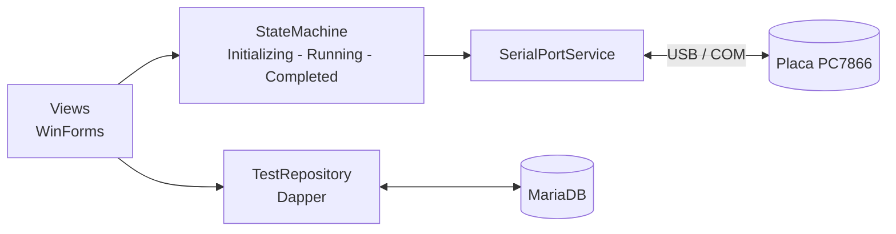

# PC7866 - Test resistivo Embega

Aplicacion Windows Forms para ejecutar ensayos resistivos del banco PC7866: mide la resistencia de cada contacto de una placa de teclado y detecta cortocircuitos.

La aplicacion permite:
- Conectar por puerto serie al dispositivo.
- Ejecutar pruebas manuales y automaticas.
- Gestionar referencias y parametros de ensayo.
- Guardar y consultar resultados en MariaDB.

## Descripcion del sistema

- Cada contacto se excita desde dos selectores ("arriba" y "abajo") controlados por MCP23017, cuyos pines pueden ser entrada, 0 V o 5 V.
- En serie, de arriba a abajo: selector "arriba", una resistencia fija, el punto intermedio donde se mide la tension, el contacto a medir y el selector "abajo".
- El punto de medida es comun a todos los puntos intermedios y se selecciona con un multiplexor.
- La resistencia se calcula a partir de las tensiones leidas en el punto intermedio (ley de Ohm). El cortocircuito se detecta comparando la resistencia medida con el umbral definido por el modelo (`Referencia.ResistenciaCortocircuito`).
- Los resultados de cada contacto, incluido el estado (OK, NOK, cortocircuito o abierto), se guardan en la base de datos.
- Esquema electrico y algoritmo: [diagrama.md](docs/diagrama.md#2-hardware-y-circuito-de-medida).

## Guias de uso

- [Modo Manual](docs/GUIA_MODO_MANUAL.md): comando a comando (diagnosis, salidas individuales, lectura analogica, filtros/coeficientes, guardar en memoria no volatil, reset).
- [Modo Automatico](docs/GUIA_MODO_AUTOMATICO.md): ejecucion de un ensayo completo por referencia (maquina de estados, resultados por paso, guardado en BD).

## Estado actual

El proyecto ya incluye funcionalidad operativa en:
- Modo manual: diagnosis, activacion de salidas, lecturas analogicas y una seccion Semiautomatico para probar un solo contacto (resistencia + cortocircuito) reutilizando la maquina de estados del modo automatico, sin guardar en BD.
- Modo automatico: ejecucion punto a punto (resistencia + cortocircuito por contacto) con maquina de estados y progreso visual.
- Parametros: gestion de referencias y parametros de ensayo, con import/export en CSV y JSON.
- Mapa de contactos: la imagen de cada referencia (con la posicion X/Y de sus contactos) muestra una bola por contacto, con su nombre dentro (hasta cuatro caracteres, p. ej. `X-XX`) y colores de estado durante el ensayo: gris sin medir, verde OK, rojo NOK, naranja cortocircuito y azul abierto.
- Informes: consulta de historico y detalle de resultados, con exportacion a CSV.
- Configuracion: puerto serie, conexion BD y opciones generales mediante `appsettings.json`.

## Tecnologias

- .NET SDK: `net10.0-windows`
- UI: Windows Forms
- Base de datos: MariaDB / MySQL
- Acceso a datos: Dapper + MySqlConnector

Dependencias NuGet principales:
- `Dapper`
- `MySqlConnector`
- `System.IO.Ports`
- `PdfSharpCore` y `SixLabors.ImageSharp` (referenciadas en el proyecto; los informes se exportan hoy a CSV)

## Requisitos

- Windows 10/11
- .NET SDK compatible con `net10.0-windows`
- MariaDB o MySQL accesible desde el PC
- Dispositivo conectado por puerto COM

## Puesta en marcha

1. Restaurar paquetes:

```bash
dotnet restore
```

2. Compilar:

```bash
dotnet build
```

3. Ejecutar:

```bash
dotnet run
```

4. Pruebas automaticas (sin hardware; formula de resistencia, clasificacion y parseo de respuestas):

```bash
dotnet test PC7866.slnx
```

## Configuracion

La configuracion se persiste en `appsettings.json` junto al ejecutable.

Ejemplo de claves principales:

```json
{
  "DefaultPortName": "COM3",
  "DefaultBaudRate": 115200,
  "DefaultTimeout": 5000,
  "DatabaseServer": "127.0.0.1",
  "DatabaseName": "control_electrico_salud",
  "DatabaseUser": "root",
  "DatabasePassword": "<valor cifrado DPAPI>",
  "DatabasePort": 3306,
  "MaxRetries": 3,
  "DelayBetweenCommandsMs": 100,
  "AutoSaveResults": true,
  "ApplicationTitle": "PC7866 - Test Resistivo Embega",
  "ShowDetailedLogs": true
}
```

Notas:
- La contrasena de BD se guarda cifrada con DPAPI a nivel de usuario Windows.
- Si se usa un fichero antiguo con password en texto plano, al guardar configuracion se reescribe cifrado.

## Protocolo serie (resumen)

Comandos principales:
- `D`: Diagnosis (subcomandos `T`=total, `1`=ADS1115, `2..7`=MCP23017 0x20-0x25, `V`=version, `G`=leer config, `C`=temperatura)
- `M`: Configuracion de direccion (entrada/salida) de pines de un MCP23017
- `S`: Activacion de salidas de un MCP23017 (16 bits, 4 hex; una trama por chip)
- `P`: Seleccion de pista en los multiplexores analogicos (00-48)
- `R`: Lectura analogica RAW de un canal ADS (0-3)
- `F`: Lectura analogica filtrada de un canal ADS (0-3)
- `I`: Configuracion de placa (modelo de placa, num. MCP, posiciones INH1-4, muestras, retardo)
- `Q`: Reset del microcontrolador

Respuestas:
- `O`: OK
- `N`: NOK

En modo manual y automatico se utilizan los builders de `Pc7866Commands` para construir tramas validas. Ver el detalle completo de la secuencia usada por el ensayo automatico en [GUIA_MODO_AUTOMATICO.md](docs/GUIA_MODO_AUTOMATICO.md).

## Estructura del proyecto

- `Program.cs` / `Form1.cs`: punto de entrada y ventana principal (menu, paneles, barra de estado).
- `Configuration/`: configuracion global y persistencia.
- `Models/`: modelos de dominio, comandos y resultados.
- `Services/SerialCommunication/`: puerto serie y parser de respuestas.
- `Services/Database/`: repositorio Dapper y creacion de esquema.
- `Services/StateMachine/`: ejecucion del ensayo automatico por estados.
- `Views/`: paneles UI (manual, automatico, parametros, informes) y formularios (configuracion, detalle, acerca de).
- `Utils/`: logging, import/export de parametros y tema visual.

### Vista rapida



Mas diagramas en [diagrama.md](docs/diagrama.md).

## Base de datos

Al iniciar, el repositorio puede crear/asegurar estas tablas (y migrar bases de datos antiguas). Para preparar un PC nuevo sin arrancar la aplicacion, se puede ejecutar el script [sql/01_crear_esquema.sql](sql/01_crear_esquema.sql) (`mysql -u root -p < sql/01_crear_esquema.sql`); es idempotente y deja el mismo esquema final. Si cambia el esquema en `TestRepository.InitializeDatabaseAsync`, actualizar tambien ese script.

Tablas:
- `referencias`
- `parametros_ensayo`
- `resultados`
- `resultados_detalle`

Detalles relevantes:
- Se usan claves foraneas entre resultados, detalle y referencias.
- `resultados.referencia_id` y `resultados_detalle.parametro_ensayo_id` se migran a nullable para compatibilidad con tests manuales.
- Para circuito abierto se guarda `-1` en `resistencia_medida` y se representa como infinito en UI.

## Flujo de uso recomendado

1. Configurar puerto serie y conexion BD en configuracion.
2. Crear o revisar referencias y parametros de ensayo.
3. Ejecutar test automatico con operario y lote (ver [guia de modo automatico](docs/GUIA_MODO_AUTOMATICO.md)).
4. Revisar resultado global y detalle por paso.
5. Consultar historico en informes.

Al configurar los parametros de una referencia, asigna la posicion X/Y de cada contacto sobre la imagen. El mapa muestra el nombre del contacto dentro de la bola; durante el ensayo, el color indica el estado: gris sin medir, verde OK, rojo NOK, naranja cortocircuito y azul abierto.

Para diagnostico de hardware, calibracion o pruebas puntuales sin referencia asociada, usa el [modo manual](docs/GUIA_MODO_MANUAL.md).

## Solucion de problemas

- No aparecen puertos COM:
  - Verificar cable/controlador USB-Serial.
  - Pulsar refresco de puertos en panel manual/automatico.
- Error de conexion a BD:
  - Revisar host, puerto, usuario y password en configuracion.
  - Confirmar permisos de usuario sobre el esquema.
- Tramas NOK o timeout:
  - Validar baudrate y puerto.
  - Probar diagnosis en modo manual antes de ejecutar automatico.

## Documentación adicional

- [ARCHITECTURE.md](docs/ARCHITECTURE.md): arquitectura técnica, componentes y patrones.
- [diagrama.md](docs/diagrama.md): diagramas (arquitectura, circuito de medida, máquina de estados, secuencia, algoritmo por paso, modelo de datos, clases y navegación).
- [GUIA_MODO_MANUAL.md](docs/GUIA_MODO_MANUAL.md): guía de uso del modo manual.
- [GUIA_MODO_AUTOMATICO.md](docs/GUIA_MODO_AUTOMATICO.md): guía detallada del modo automático.
- [EJEMPLO_COMANDOS_SERIE.md](docs/EJEMPLO_COMANDOS_SERIE.md): ejemplo de tramas serie enviadas en un ensayo de 5 pasos.

