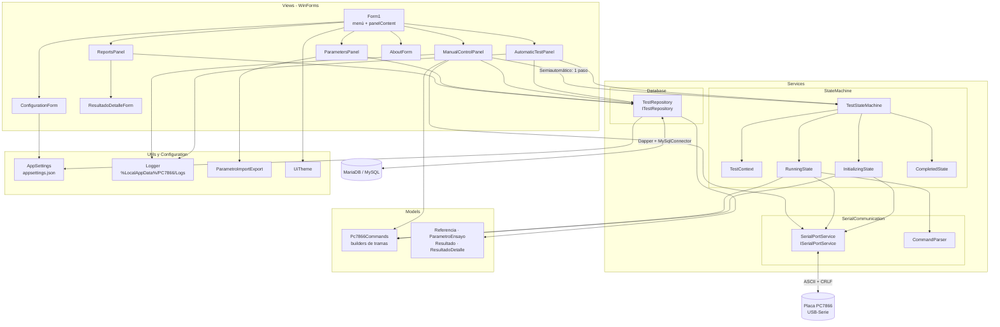
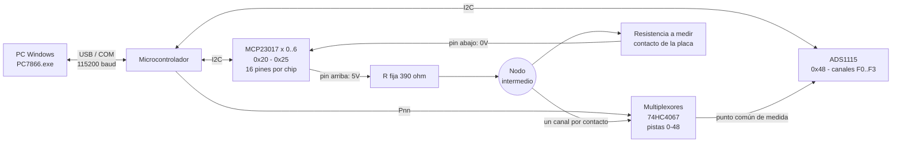
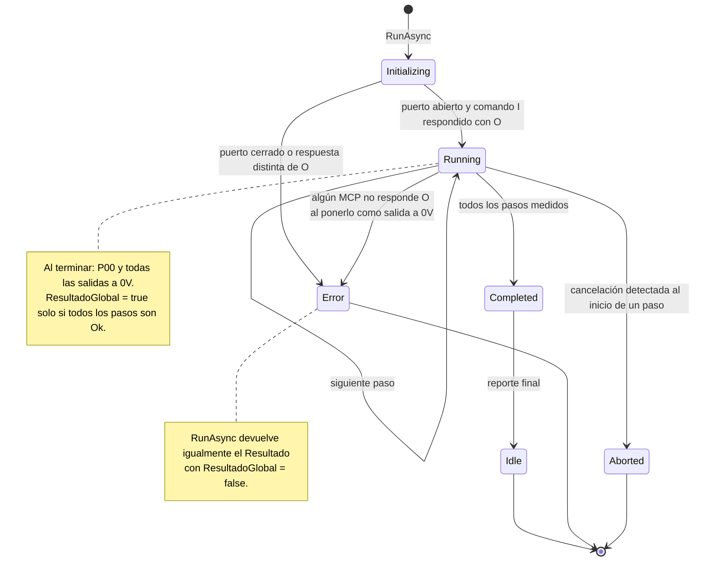
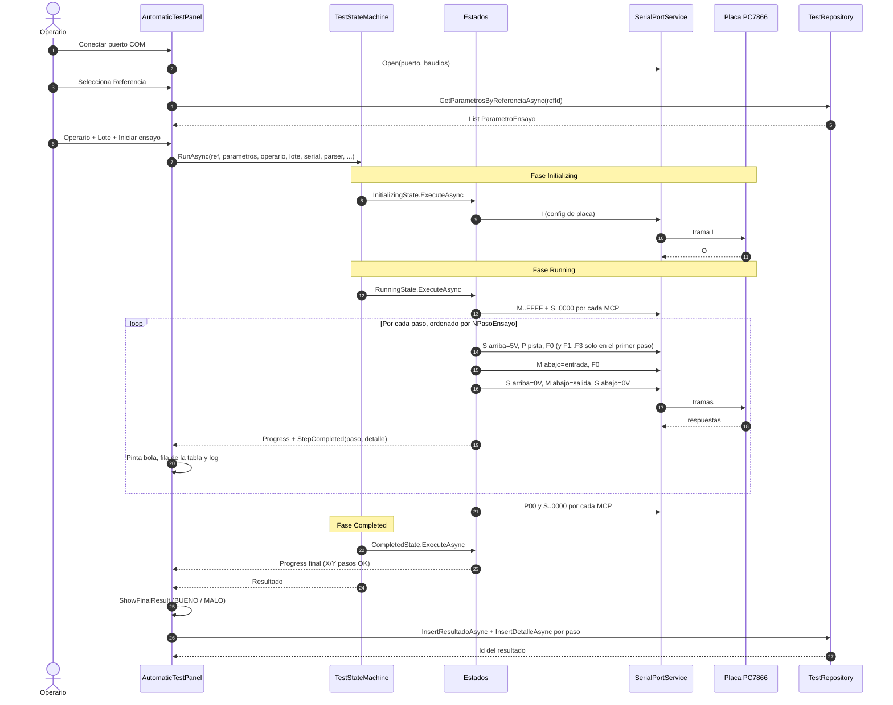
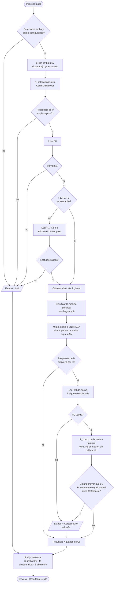
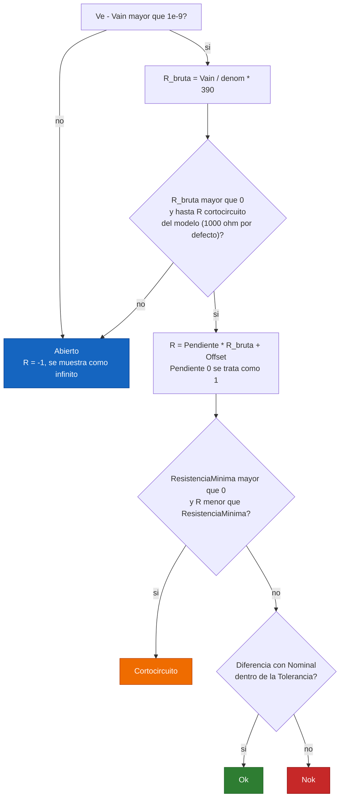
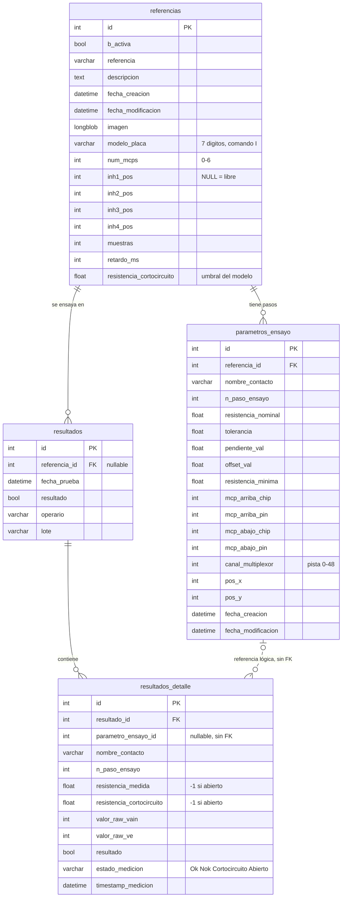
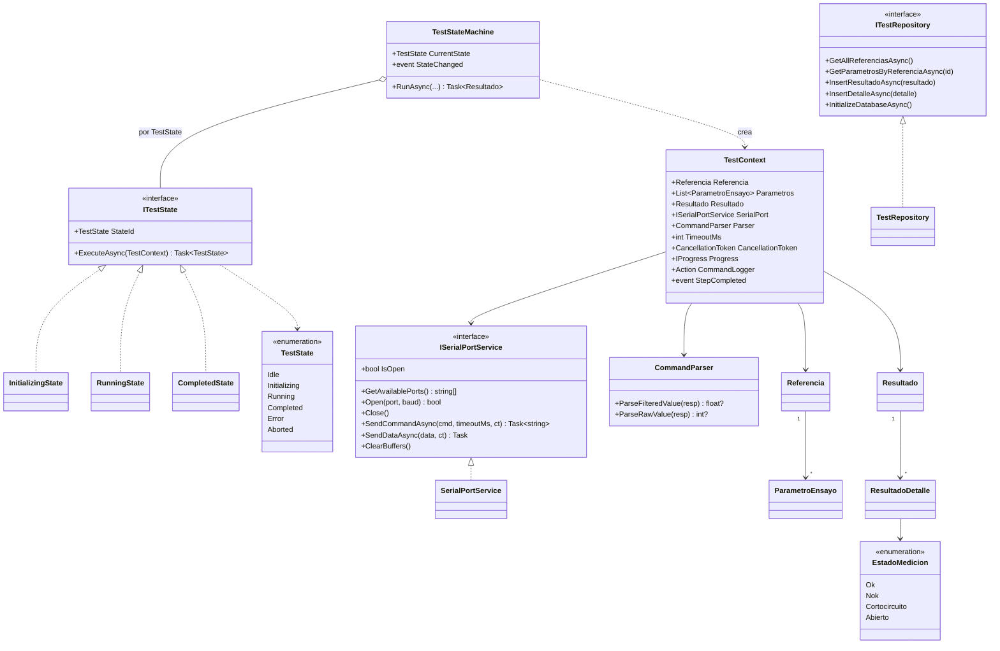
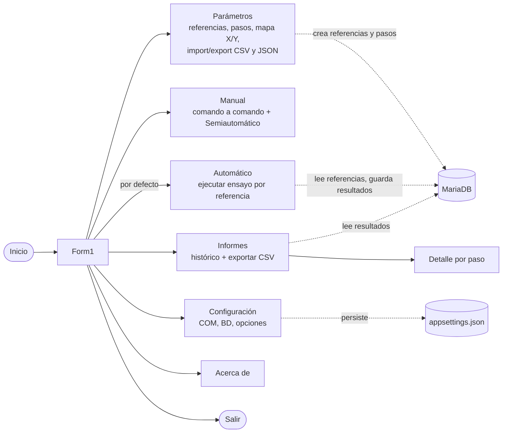

# PC7866 - Diagramas

Diagramas Mermaid del proyecto, alineados con el código (`RunningState`, `TestStateMachine`, `TestRepository`, `Pc7866Commands`). Documentación relacionada: [README](../README.md) · [ARCHITECTURE](ARCHITECTURE.md) · [Modo automático](GUIA_MODO_AUTOMATICO.md) · [Modo manual](GUIA_MODO_MANUAL.md) · [Ejemplo de tramas](EJEMPLO_COMANDOS_SERIE.md).

## Índice

1. [Arquitectura por capas](#1-arquitectura-por-capas)
2. [Hardware y circuito de medida](#2-hardware-y-circuito-de-medida)
3. [Máquina de estados del ensayo](#3-máquina-de-estados-del-ensayo)
4. [Secuencia de un ensayo automático](#4-secuencia-de-un-ensayo-automático)
5. [Algoritmo de medición de un paso](#5-algoritmo-de-medición-de-un-paso)
6. [Clasificación del estado de un paso](#6-clasificación-del-estado-de-un-paso)
7. [Modelo de datos](#7-modelo-de-datos)
8. [Clases principales](#8-clases-principales)
9. [Navegación de la aplicación](#9-navegación-de-la-aplicación)

---

## 1. Arquitectura por capas

`Form1` crea **un único** `SerialPortService` y lo comparte entre el panel manual y el automático. Cada panel que necesita BD crea su propio `TestRepository` a partir de `AppSettings`.



---

## 2. Hardware y circuito de medida

Cada contacto se mide con un divisor resistivo: la excitación sale de un pin MCP23017 ("arriba", 5V), pasa por una resistencia fija de 390 Ω, el nodo intermedio se lleva al ADS1115 mediante los multiplexores 74HC4067 (comando `P`) y la resistencia a medir cierra contra otro pin MCP23017 ("abajo", 0V).



Fórmula (idéntica en modo manual y automático):

```text
Vain   = F0 - F1
Ve     = F2 - F3
R_bruta = Vain / (Ve - Vain) * 390            (solo válida si Ve - Vain > 0)
R       = Pendiente * R_bruta + Offset         (calibración lineal, solo en la medida principal)
Abierto si R_bruta <= 0  o  R_bruta > R cortocircuito del modelo (1000 ohm si no definido)
```

---

## 3. Máquina de estados del ensayo

`TestStateMachine.RunAsync` ejecuta `ExecuteAsync` de cada estado en bucle hasta llegar a `Idle`, `Error` o `Aborted`. **`Error` y `Aborted` no pasan por `CompletedState`.**



> Cancelar **durante** un comando serie lanza `OperationCanceledException`, que sale de `RunAsync` y la UI no guarda nada. Cancelar **entre** pasos devuelve el resultado parcial con estado `Aborted`, que la UI sí muestra y guarda.

---

## 4. Secuencia de un ensayo automático



---

## 5. Algoritmo de medición de un paso

Lógica de `RunningState.MedirPasoAsync`. El paso se restaura siempre en el bloque `finally`.



---

## 6. Clasificación del estado de un paso

Se aplica a la medida principal, antes de la fase de cortocircuito. Después, la fase de cortocircuito puede sobrescribir el estado con `Cortocircuito`.



Color de la bola en el mapa de contactos: gris sin medir · verde `Ok` · rojo `Nok` · naranja `Cortocircuito` · azul `Abierto`.

---

## 7. Modelo de datos

Esquema creado y migrado por `TestRepository.InitializeDatabaseAsync`. `parametro_ensayo_id` **no** tiene clave foránea, y `resultados.referencia_id` y `resultados_detalle.parametro_ensayo_id` admiten `NULL` por compatibilidad con pruebas manuales.



---

## 8. Clases principales



---

## 9. Navegación de la aplicación

Los paneles se crean la primera vez que se abren y después solo se muestran u ocultan. El panel automático es el que se abre al iniciar.


